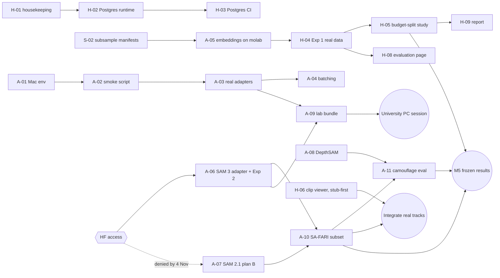

# WildTriage Execution Roadmap: Saif & Shahoud

**Written:** Sunday 25 October 2026 (end of Week 1).

**Supersedes:** the schedules in [`PROJECT_PLAN.md`](PROJECT_PLAN.md) §8 and [`AUDIT_2026-10-24.md`](AUDIT_2026-10-24.md) §8. Their scope, architecture and research design still stand.

**Labels:**
- **[V]** verified in the repo, by running something, or on a linked source.
- **[A]** assumption: confirm it, and correct this file if it is wrong.
- **[U]** unknown.
- **[R]** recommendation.

---

## 1. Executive summary and original objectives

**The project.** WildTriage is a camera-trap triage and verification platform. It takes camera-trap images and videos and turns them into verified species records. Its measured claim is how much human review it saves at a controlled error rate.

**Original objectives** (from the first brief, 18 Oct):

| # | Objective | Current scope decision |
|---|---|---|
| O1 | Detect, classify, segment and track animals in camera-trap images and video | **In scope (P0):** MegaDetector → BioCLIP 2 → SAM 3 video tracking |
| O2 | Robust to night/IR, motion blur, camouflage, varied habitats | P0 quality flags + day/night guarantees; camouflage via DepthSAM (minimal P0) |
| O3 | Aerial imagery "where technically feasible" | **P2** (none of the 3 papers is aerial) |
| O4 | Population estimation | Replaced by activity indices: independent events, RAI, MaxN. True density needs data we don't have |
| O5 | Built on three 2026 papers from approved venues | SA-FARI (CVPR 2026), DepthSAM (CVPR 2026), StreamTrap (ECCV 2026; swap pending instructor approval) |
| O6 | Cohesive product: backend, database, interactive frontend, evaluation | Monorepo: FastAPI + Postgres queue + React |
| O7 | One defensible, testable research contribution | Exp 1: how to split a review budget between *certifying* auto-acceptance and *learning* site adaptation, and how often guarantees fail at real sites (audit §3.3) |
| O8 | Zero monetary cost | All development is free; only publication (registration or journal fees) costs money |

**Deadline.** **13 Dec 2026** [A]. This is the plan's assumed end: 8 weeks from 19 Oct, matching "two months" in the brief. **Confirm it with the instructor.**

**Strategy in one line.** Do every GPU-free task on the home machines now. Run GPU batch jobs on **molab, Colab or the Mac** while university access is pending. Arrive at the university PC with a tested bundle, so the first session runs SAM 3 and DepthSAM, not installs.

---

## 2. Current progress audit and outstanding requirements

### 2.1 Done

All verified 25 Oct in `C:\dev\wildtriage` and on GitHub.

| Area | State | Evidence |
|---|---|---|
| Repository | `github.com/Shahoud867/wildtriage`, branch `main`, 7 commits, local = remote | `git rev-parse main origin/main` |
| CI | 3 most recent runs **passed** | `gh run list` |
| Visibility | **PUBLIC** (the plan said private). Decide in §15 step 1. | `gh repo view` |
| Platform skeleton | Upload with content sniffing + dedup, Postgres job queue, ingest → stub inference → triage → review → audit → analytics; 13 backend tests | `backend/tests` |
| ML package | Device selection (CUDA → MPS → CPU), calibration, conformal (CRC/LTT/ACI), selection strategies, policy, Balanced-Softmax heads + WiSE, VRAM-aware registry; 45 tests | `ml/tests` |
| Frontend | Login, projects, upload, jobs, media grid/detail, review with hotkeys, analytics, models; builds | `frontend/` |
| Scripts | Windows PowerShell + macOS/Linux bash twins; 15 tests; ShellCheck clean | `scripts/` |
| Exp 1 simulator | Runs on synthetic data; 3 smoke tests | `research/experiments/exp1_triage.py` |
| **Site selection (new 25 Oct)** | **30 Snapshot Serengeti sites** (10 dev / 20 test) from 212 qualifying; monthly intervals; day/night by clock hour | `research/manifests/lila_{dev,test}.parquet`, `lila_sites_summary.csv` |
| **Embedding extractor (new 25 Oct)** | `extract_embeddings.py`: streams images anonymously from LILA's public bucket; BioCLIP 2; batches; resumable (`--skip-existing`); `--mock` and `--limit` modes; writes per-site `.npz` in exactly the format `exp1_triage.load_site` reads | `research/data_prep/extract_embeddings.py` |

### 2.2 Problems found in the new work

Each is fixed by a task below.

| # | Issue | Impact | Fix (task) |
|---|---|---|---|
| P1 | **544,015 images** across 30 sites (dev 161,908; test 382,107) | Streaming that many takes ~0.3–0.5 TB of transfer [A: ~0.5–1 MB/image] and days of extraction | Stratified subsample: ≤18 intervals × ≤120 images per site, about 60k images (**S-02**) |
| P2 | All 30 sites are from **one dataset** (Snapshot Serengeti) | Weak generality claim; the plan said ≥3 datasets | MVP keeps 1 dataset; add 2 more LILA datasets in Stage 2 (**S-10**) |
| P3 | Manifests are **whole images**, though the log calls them "crops". StreamTrap uses MegaDetector crops enlarged 50%. | Accuracy and comparability with Paper 3 | MVP: whole images, documented as a deviation. Stage 2: MegaDetector crops (**S-11**) |
| P4 | Images with several species are de-duplicated by `image_id`, keeping one label | Label noise | Keep single-species images only (**S-02**) |
| P5 | `research/results/exp1_synthetic_2026-10-25.txt` is **UTF-16**: PowerShell redirection made it show as binary in git | Unreadable diffs | Re-save as UTF-8 (**H-01**) |
| P6 | No tests for `select_sites_lila.py` or `extract_embeddings.py` | Regressions unnoticed | Fixture-based tests (**S-03**) |
| P7 | A stale copy remains in OneDrive without today's commits | Someone edits the wrong copy | Rename it `wildtriage_OLD_DO_NOT_EDIT` (**H-01**) |

### 2.3 Outstanding

| Requirement | Status | Blocked by |
|---|---|---|
| Real MegaDetector + BioCLIP 2 inference in the app | Not run | Nothing (can be done at home) |
| BioCLIP 2 embeddings for the 30 sites | Extractor ready; not run | P1 subsample |
| Exp 1 on real data | Not started | Embeddings |
| SAM 3 on SA-FARI (Paper 1) | Not run | **HF access [U]**, CUDA GPU |
| DepthSAM reproduction (Paper 2) | Not run | CUDA GPU (molab or university PC) |
| Video pipeline (ffmpeg + tracks in the UI) | Stubbed | Nothing (stub-first) |
| Postgres actually running | Never run | Nothing |
| Exports, charts, comparison view, settings | Missing | Nothing |
| Course report + demo | Not started | Results |

### 2.4 Missing information

| # | Unknown | Affects | Default until answered |
|---|---|---|---|
| U1 | Which machine Saif uses: the MacBook Pro M1 Pro, the Quadro T1000 PC, or both | Task assignment | **[A] Saif = MacBook.** If Saif has the T1000, swap "MPS" for "CUDA fp16, 3.5 GB budget" in his tasks. |
| U2 | When university-PC access starts, and what IT allows | §7 timing | The plan works without it until M3 (15 Nov) |
| U3 | Hugging Face access for SAM 3 / SA-FARI | Paper 1 | Plan B on 4 Nov: SAM 2.1 |
| U4 | Instructor approval of the Paper 3 swap; grading rubric; final deadline; AI-use policy | Scope | 13 Dec; all three papers required |
| U5 | Should the repo stay **public**? | Integrity; CI minutes | §15 step 1 |
| U6 | Hours per week each person can give | Cut list | ~15 h/week each [A] ≈ 105 h each by 13 Dec |

---

## 3. Available resources, environments and constraints

| Resource | Spec | Good for | Not for | Status |
|---|---|---|---|---|
| **Shahoud: HP laptop** | i5-1235U, 20 GB RAM, Iris Xe (no CUDA), ~180 GB free; Windows 11; Docker; git + `gh` logged in as `Shahoud867` | Backend, frontend, Docker stack (stub models), Exp 1 analysis (CPU NumPy), data prep, writing | Any model inference beyond tiny CPU tests | [V] |
| **Saif: MacBook Pro M1 Pro** | 32 GB unified memory, 512 GB SSD; PyTorch MPS | MegaDetector + BioCLIP 2 on MPS in fp32; embedding extraction (slow but works); development | SAM 3, DepthSAM (CUDA only); Docker GPU | [A] U1 |
| T1000 PC | 4 GB CUDA (Turing, fp16), 32 GB RAM | Light CUDA models | Anything over 3.5 GB of GPU memory | [U] availability |
| **University PC** | RTX 4000 Ada 20 GB, i7-14700, 32 GB, ~1.7 TB free; managed Windows 11 | SAM 3, DepthSAM, SA-FARI evaluation, final runs, demo host | Anything needing admin rights (unconfirmed) | [V] specs; [U] access |
| **molab** | Free preview; 4 CPU / 32 GB; opt-in **96 GB GPU**; 12 h sessions; 90 min idle shutdown | Heavy batch jobs *now*: embeddings, SAM 3 once access arrives, DepthSAM | Long-lived servers; storage that persists (unverified) | [V] marimo blog |
| Google Colab (free) | Usually T4 16 GB; dynamic limits | Backup for embeddings and short SAM 3 tests | Guaranteed time | [V] secondary |
| Kaggle | ~30 GPU h/week (T4/P100) | Second backup | — | [V] third-party |
| GitHub | Public repo: unlimited Actions minutes; private: 2,000/month | CI, PRs, Issues/Projects board | Data storage | [V] |
| Shared drive | Shahoud's university OneDrive [A] | `.npz` embeddings, results, model outputs (never code) | Git repos, `.venv`, `node_modules` | [A] |
| Data | LILA and SA-FARI buckets anonymously readable (no billing); SA-FARI annotations and SAM 3 weights gated on HF | — | — | [V] 24 Oct |

**Constraints:**
- Zero cost: never attach a credit card anywhere.
- SAM 3 and DepthSAM are CUDA-only.
- Two people.
- A ~7-week horizon.

---

## 4. Home-PC execution plan

**Principle.** Every task here runs without the university PC. GPU work goes to the Mac, molab or Colab. Each task is sized to fit in a free cloud session (≤12 h, resumable).

### 4.1 Environments to set up once

| Who | Machine | Commands | Done when |
|---|---|---|---|
| Shahoud | Laptop | `powershell -ExecutionPolicy Bypass -File scripts\native\setup.ps1 -Machine laptop` | `cd ml; ..\.venv\Scripts\python -m pytest -q` passes |
| Shahoud | Laptop | `docker compose --profile stub up --build`, then `docker compose exec api python -m app.cli create-user --email shahoud@example.com --name Shahoud --role admin` | App at `http://localhost:8080`; a stub upload produces review items. **First real Postgres run.** |
| Saif | Mac | `git clone https://github.com/Shahoud867/wildtriage.git ~/dev/wildtriage && cd ~/dev/wildtriage && bash scripts/native/setup.sh mac` | Setup prints `device: mps | dtype: torch.float32` |
| Saif | Mac | `.venv/bin/python -m pytest -q ml/tests scripts/tests` | All pass on macOS |
| Both | molab | Create a free account. **No card.** Store the HF token only in molab's secret or environment feature, never in a notebook cell. | A notebook runs `nvidia-smi` and shows the 96 GB GPU |

### 4.2 Shared cloud runner for batch jobs

Every GPU batch job (embeddings, SAM 3, DepthSAM) uses the same three cells in molab or Colab. Nothing lives only in the notebook.

```bash
git clone https://github.com/Shahoud867/wildtriage.git && cd wildtriage
pip install -e "ml[gpu]" pandas pyarrow
python research/data_prep/extract_embeddings.py --manifest research/manifests/lila_dev_sub.parquet \
  --output-dir research/embeddings/lila_dev --batch-size 128 --skip-existing
```

Then copy `research/embeddings/` to the shared drive. Re-running the same command resumes, so a 12-hour cut-off costs one site at most.

---

## 5. Saif's task assignments

**Track:** models and video. Saif owns `ml/wildtriage_ml/adapters/`, `research/experiments/exp2_*.py`, `exp3_*.py` and `third_party/`.

| ID | Task | Prereq | Output | Done when | Est. |
|---|---|---|---|---|---|
| **A-01** | Mac environment + tests (§4.1) | Repo access | Working `.venv` | All tests pass on macOS | 1 h |
| **A-02** | **Real-model smoke script** `research/smoke/run_models.py`: MegaDetector + BioCLIP 2 on 50 LILA images (URLs from the manifest). Print boxes, top-5 species, latency, peak memory. | A-01 | Script + `research/results/smoke_mps.md` | Runs on MPS; ≥45/50 images produce boxes or a correct empty result; numbers recorded | 4 h |
| **A-03** | Fix the `[A] verify` lines in `adapters/megadetector.py` and `bioclip.py` against the installed packages | A-02 | PR `saif/real-adapters` | Smoke script uses the adapters, not ad-hoc code | 3 h |
| **A-04** | **Batching** in `backend/app/workers/tasks/inference.py`: detect and classify in batches. Add `detect_batch` / `classify_batch` to the adapter protocol with per-item fallbacks. | A-03; coordinate with Shahoud (shared file) | PR | 200 images run through the app ≥5× faster than per-item [A target]; backend tests pass | 5 h |
| **A-05** | **Run embedding extraction** for dev, then test, on molab (fallback: Colab, then the Mac overnight) | **S-02** subsample | `research/embeddings/lila_{dev,test}/*.npz` on the shared drive | 30 valid `.npz` files; `exp1_triage.load_site` opens every one | 2 h hands-on + runtime |
| **A-06** | Prepare **SAM 3**: implement `adapters/sam3.py` from the repo's video notebook (chunked, ≤30 s at 6 fps); write `exp2_video_counts.py` (SA-FARI test subset, sam3 `veval`, MaxN) | HF access (U3); test on molab | PR + `exp2` script | Runs on **3 SA-FARI clips** on molab, printing masklets and a MaxN | 8 h |
| **A-07** | **Plan B if no SAM 3 access by Wed 4 Nov:** `adapters/sam2.py` (SAM 2.1, Apache-2.0) prompted with MegaDetector boxes | A-03 | PR | Same 3-clip test passes | 4 h |
| **A-08** | Prepare **DepthSAM**: clone, pin requirements, `exp3_camouflage.py` for COD10K-test reproduction | Weights (Google Drive per README) | Script + `third_party/DepthSAM.lock` | Runs on molab; COD10K numbers within a stated tolerance of the paper | 6 h |
| **A-09** | **University-PC bundle** (§7.2) and `scripts/lab/preflight.ps1` | A-03, A-06 | `wildtriage-lab-bundle` on a USB drive or the shared drive | Preflight passes on Saif's machine in dry-run mode | 3 h |
| **A-10** | SA-FARI subset run (≥150 test clips) + MegaDetector + ByteTrack baseline | A-06; molab or university PC | `research/results/exp2_*.json` | Official evaluator numbers + MaxN error table | 8 h |
| **A-11** | DepthSAM on SA-FARI small/challenging crops vs SAM 3 masks | A-08, A-10 | `exp3` results | IoU/Dice table | 4 h |

---

## 6. Shahoud's task assignments

**Track:** platform, Exp 1 and the report. Shahoud owns `backend/` (except the inference batching in A-04), `frontend/`, `research/data_prep/`, `research/experiments/exp1_triage.py`, `docs/`, CI and repo administration.

| ID | Task | Prereq | Output | Done when | Est. |
|---|---|---|---|---|---|
| **H-01** | Housekeeping: rename the OneDrive copy; re-save the UTF-16 results file as UTF-8; set the repo visibility (§15 step 1); protect `main` (PRs + CI required) | — | Commit `chore: housekeeping` | `git log` shows it; `main` rejects direct pushes | 1 h |
| **H-02** | Run the stack in Docker with Postgres (§4.1) and fix whatever breaks | — | PR `shahoud/postgres-runtime` | Upload → stub triage → review works on Postgres; queue `SKIP LOCKED` exercised | 3 h |
| **H-03** | Postgres in CI (a GitHub Actions `services: postgres` job running the backend tests) | H-02 | `ci.yml` change | CI runs the backend tests twice, on SQLite and Postgres, both green | 2 h |
| **S-02** | **Subsample manifests:** single-species only; per site the first ≤18 intervals with ≥50 images; ≤120 images per interval, stratified by day/night; seed 0 → `lila_{dev,test}_sub.parquet` + summary | — | PR | About 60k images total [A]; every site has ≥12 intervals; summary committed | 3 h |
| **S-03** | Tests for `select_sites_lila.py` and `extract_embeddings.py` (tiny fixture JSON; `--mock` mode end to end) | — | `research/tests/test_data_prep.py` | Runs in CI in under 10 s | 3 h |
| **H-04** | **Exp 1 on real data:** `exp1_triage.py --sites research/embeddings/lila_dev/*.npz`; add the StreamTrap MSP adapt-or-skip and fixed-threshold baselines; write results as JSON | A-05 (dev) | `research/results/exp1_dev_*.json` + table | All dev sites run; table shows every policy | 8 h |
| **H-05** | **Budget-split analysis** (the research question): sweep the calibration fraction {0.1–0.6} × budget {1, 5, 10, 25%} × α {5, 10%}; record guarantee-violation rate per site; bootstrap confidence intervals | H-04 | Figures + `docs/report/exp1.md` | Plots: coverage, final accuracy and violation rate vs split | 10 h |
| **H-06** | Frontend: clip viewer (overlay video + track timeline), built against **stub tracks first** | — | PR | Stub video shows a timeline; swaps to real tracks once A-06 lands | 8 h |
| **H-07** | Frontend: analytics charts, CSV/COCO export, auth guard, empty/error states, mobile layout | — | PRs | Playwright happy path passes | 10 h |
| **H-08** | Evaluation page: risk–coverage and reliability charts from `evaluation_runs` | H-04 | PR | Exp 1 results visible in the app | 4 h |
| **H-09** | Report in **workshop-paper format** (8 pages + appendix); start the outline in W3 | — | `docs/report/` | Draft by 2 Dec | 15 h |

**Shared:** demo script and rehearsal (W7–W8), final test-site run (M5).

---

## 7. University-PC preparation and execution plan

### 7.1 What only the university PC (or molab) can do

| Job | Why there | Fallback |
|---|---|---|
| SAM 3 on SA-FARI (A-06/A-10) | CUDA; about 8 GB [A] | molab (96 GB); Colab T4 for short tests |
| DepthSAM (A-08/A-11) | CUDA; NC dependency; ~6 GB [A] | molab |
| Final test-site runs + demo host | Stable, local, fast | molab for compute; the laptop for the demo with precomputed results |
| Long resumable batches (overnight) | No 12-hour limit (if IT allows) | molab in 12-hour chunks |

### 7.2 Prepare at home: the lab bundle (owner Saif; A-09)

Put this on a USB drive and the shared drive:

```
wildtriage-lab-bundle/
  README_LAB.md            # this section, printed
  repo/                    # git clone of main (or pull on the day)
  wheelhouse/              # offline Python wheels, if IT blocks pip (see below)
  postgres-16-win-x64.zip  # EDB "zip archive" binaries (no installer, no admin)
  node-v22-win-x64.zip     # portable Node.js
  weights/                 # BioCLIP 2 HF cache; SAM 3 checkpoint once access is granted; DepthSAM weights
  data/sa_fari_test_subset/  # ≥150 SA-FARI test clips (6 fps JPEG folders) + annotations
  env/lab.env              # copy of .env for the lab (no secrets; HF token typed on the day)
```

**Offline wheels,** only if IT blocks the internet. Build them on any machine with Python 3.12:

```bash
pip download -d wheelhouse --only-binary=:all: --platform win_amd64 --python-version 3.12 torch torchvision --index-url https://download.pytorch.org/whl/cu128
```

```bash
pip download -d wheelhouse --only-binary=:all: --platform win_amd64 --python-version 3.12 -e ./ml[gpu] -e ./backend
```

On the day, install with `uv pip install --no-index --find-links wheelhouse ...`.

**Preflight script** `scripts/lab/preflight.ps1` (A-09). It checks, and prints PASS/FAIL for each:
- `nvidia-smi` shows the RTX 4000 Ada;
- Python 3.12 is available (or `uv python install 3.12` works);
- ≥200 GB free on the data drive;
- HTTPS reaches `huggingface.co`, `storage.googleapis.com` and `download.pytorch.org`;
- writable user folders exist (`D:\wildtriage-data` or `%USERPROFILE%`);
- whether `docker` exists (optional).

### 7.3 University PC: first-session sequence (target ≤ 3 hours to first SAM 3 output)

| Step | Time | Action | Check |
|---|---|---|---|
| 1 | 0:00 | Copy the bundle; run `scripts\lab\preflight.ps1` | All PASS, or note the FAILs |
| 2 | 0:15 | `scripts\native\setup.ps1 -Machine lab` (online), or the wheelhouse install (offline) | `torch.cuda.is_available()`; bf16 supported |
| 3 | 0:45 | `hf auth login` (type the token; don't save it on a shared PC), then open the SAM 3 checkpoint once | Weights cached |
| 4 | 1:00 | `python -m pytest -q ml/tests` and the A-02 smoke script with `--device cuda` | Pass; latency recorded |
| 5 | 1:15 | **SAM 3 on 3 SA-FARI clips** (A-06) | Masklets + MaxN printed; peak VRAM logged |
| 6 | 1:45 | Start the **long resumable job**: A-10 SA-FARI subset (`--skip-existing`) | Progress log growing |
| 7 | 2:15 | DepthSAM COD10K reproduction (A-08), if time allows | Numbers within tolerance |
| 8 | 2:45 | Copy results to the shared drive; `git push` the code changes; note for IT any blocker found | Results on the drive |
| 9 | (if allowed) | Leave A-10 running overnight; otherwise stop it cleanly. It resumes next time. | — |

### 7.4 Fallbacks

| Problem | Action |
|---|---|
| No admin rights | Native path: uv + portable Postgres + portable Node (no installers) |
| No internet or pip blocked | Wheelhouse + `weights/` from the bundle |
| PyTorch wheel/CUDA driver mismatch | Try the `cu126` wheels; check `nvidia-smi` for the driver's CUDA version |
| GPU busy or shared | Book slots; run A-10 on molab instead |
| Disk wiped at logout | Keep everything on the bundle drive; results go to the shared drive at every step |
| SAM 3 access denied | A-07 (SAM 2.1); tell the instructor |
| Out of GPU memory | Chunk clips to 15 s; SAM 3.1; batch size 1 |
| No university access before 15 Nov | Run everything on molab; use the university PC only for the demo, or present on the laptop with precomputed results |

---

## 8. Parallel-work matrix and dependency map

### 8.1 Dependency map



### 8.2 What runs in parallel

| Week | Saif (models/video) | Shahoud (platform/Exp 1) | Must be sequential |
|---|---|---|---|
| W2 (26 Oct–1 Nov) | A-01 → A-02 → A-03 | H-01, S-02, H-02, S-03 | **S-02 before A-05** |
| W3 (2–8 Nov) | A-05 (molab), A-04, A-06 or A-07 | H-03, H-06, start H-04 on the first dev sites | **A-05 dev before H-04** |
| W4 (9–15 Nov) | A-08, A-09, university session | H-04, H-07 | **A-03 before A-09** |
| W5 (16–22 Nov) | A-10, A-11 | H-05, H-08 | **A-10 before integrating tracks** |
| W6 (23–29 Nov) | Final runs (test sites, SA-FARI) | Integration, Playwright, Exp 1 test run | **Test sites only after the M4 freeze** |
| W7–W8 | Demo data, figures | Report, demo | — |

### 8.3 Interfaces between the two tracks

| Contract | Producer → consumer | File | Rule |
|---|---|---|---|
| Site embeddings `.npz` (keys `embeddings, labels, interval, is_night, text_embeddings, logit_scale, classes, image_ids`) | Saif → Shahoud | `extract_embeddings.py` docstring; `exp1_triage.load_site` | Changing a key needs a PR reviewed by both |
| Adapter protocol (`Detector`, `SpeciesClassifier`, `VideoTracker`, `ModelInfo.devices`) | Saif → backend | `ml/wildtriage_ml/adapters/base.py` | Additive changes only (new methods with defaults) |
| Track JSON for the clip viewer | Saif → Shahoud | `backend/app/schemas.py` (`Track`) | Shahoud defines the schema in H-06; Saif fills it |
| Results JSON (`evaluation_runs`) | both → report and UI | `research/results/*.json` | Includes the git commit + config |

---

## 9. Prioritised roadmap and timeline

**Priorities:**
- **P0:** required for the course.
- **P1:** strongly improves the grade, the research or the demo.
- **P2:** only after P0 and P1 are done.

| Week | Dates | P0 | P1 | Gate at week's end |
|---|---|---|---|---|
| W2 | 26 Oct–1 Nov | H-01, A-01–A-03, S-02, H-02 | S-03 | **M1** |
| W3 | 2–8 Nov | A-05, A-04, A-06 (or A-07 on 4 Nov), H-04 started, H-06 | H-03 | **M2** |
| W4 | 9–15 Nov | A-08, A-09, H-04 done, H-07 started | First university session | **M3 gate** |
| W5 | 16–22 Nov | A-10, H-05, A-11 (minimal) | H-08 | **M4** |
| W6 | 23–29 Nov | Frozen test-site runs; integration; Playwright | Comparison panel | **M5** |
| W7 | 30 Nov–6 Dec | **Feature freeze Wed 2 Dec**; report draft; demo video | Hugging Face Space read-only demo | **M6** |
| W8 | 7–13 Dec | Rehearse demo twice; final checklist; submit | — | **M7** |

**Cut list** (in this order, decided at M3):
1. Comparison panel.
2. In-app adaptation.
3. Server-sent events.
4. Hugging Face Space demo.
5. DepthSAM on SA-FARI crops (keep the COD10K reproduction).
6. SA-FARI subset down to 75 clips.

**Never cut:**
- the three-paper coverage;
- Exp 1 on real sites;
- the review loop;
- tests;
- the report.

---

## 10. Technical architecture, integration strategy and workflow

**Architecture unchanged** (plan §5): React → FastAPI → Postgres (data and job queue). Workers are routed by queue:
- `cpu`: any machine;
- `gpu`: Mac (MPS) or T1000;
- `gpu-heavy`: university PC (CUDA).

Batch research jobs reuse `wildtriage_ml` directly. No code is duplicated between the app and the experiments.

**Git workflow:**

| Rule | How |
|---|---|
| `main` is always green and deployable | Branch protection: PR + passing CI required (H-01) |
| Branch names | `saif/<topic>`, `shahoud/<topic>`; one task ID per branch (e.g. `saif/A-03-real-adapters`) |
| PR size | Under 400 changed lines where possible; title starts with the task ID |
| Review | The other person reviews within 24 h; shared files (§8.3) always need review |
| Commits | Conventional style (`feat(ml): …`), as in the existing history |
| Sync | Rebase on `main` daily: `git pull --rebase origin main` |
| Data | Never in git: `.npz`, images, weights go to the shared drive; manifests and small result JSON are fine |
| Tracking | GitHub Issues, one per task ID, on a Project board (Todo / Doing / Review / Done) |
| Check-ins | 15 min async daily (what's done, next, blocked); a 30-min call Mon + Fri |

**Ownership by folder** (avoids conflicts):

| Saif | Shahoud | Both (review required) |
|---|---|---|
| `ml/wildtriage_ml/adapters/`, `third_party/`, `research/experiments/exp2*`, `exp3*`, `research/smoke/`, `scripts/lab/` | `backend/` (except inference batching), `frontend/`, `research/data_prep/`, `research/experiments/exp1*`, `docs/`, `.github/` | `ml/wildtriage_ml/adapters/base.py`, `backend/app/schemas.py`, `backend/app/workers/tasks/inference.py`, `research/configs/` |

---

## 11. Testing, validation and quality assurance

**Quality gate for every PR:**
- CI green: ML, backend, research, scripts, ShellCheck, frontend build and test.
- New behaviour has a test.
- No secrets, data or weights in the diff.

**Tests to add:**

| Test | Owner | When |
|---|---|---|
| Data-prep fixtures: site selection, subsample, `--mock` extraction end to end | Shahoud (S-03) | W2 |
| Adapter "golden" tests on 5 fixed images (skipped without torch; run on the Mac and the university PC) | Saif | W3 |
| Postgres-backed backend tests in CI | Shahoud (H-03) | W3 |
| Playwright: login → upload → job → review → export | Shahoud | W6 |
| Results reproducibility: re-run 1 dev site from its JSON config → same numbers | Shahoud | W5 |

**Research validity checklist** (before M5):
- [ ] Dev and test sites never mixed; test run once from a tagged commit (`git tag exp1-final`)
- [ ] Calibration and thresholds use only past intervals and random calibration labels
- [ ] SAM 3 evaluated only on SA-FARI **test**
- [ ] 3 seeds; bootstrap 95% confidence intervals over sites; negative results kept
- [ ] Deviations from the StreamTrap protocol documented (whole images, one dataset, subsampling)

---

## 12. Risks, blockers and contingency plans

| # | Risk | Likelihood / impact | Early signal | Contingency |
|---|---|---|---|---|
| 1 | SAM 3 access slow or denied | M / H | No approval by 4 Nov | A-07 SAM 2.1; inform the instructor |
| 2 | University PC unavailable or locked down | M / H | No access by 9 Nov | molab for all CUDA jobs; demo on the laptop with precomputed results |
| 3 | Embedding extraction too slow (network) | M / M | <2 sites/hour on molab | Shrink to ≤80 images per interval; run dev and test on two notebooks at once |
| 4 | Exp 1 shows no policy beats least-confidence | M–H / M | M3 dev results | The budget-split framing (H-05) is the contribution either way |
| 5 | Scope exceeds ~210 person-hours | M / H | M3 behind | Apply the cut list at M3 |
| 6 | Merge conflicts in shared files | M / L | PR conflicts | Ownership map; small PRs; daily rebase |
| 7 | molab preview limits change | L–M / M | Errors or quota messages | Colab, then Kaggle; jobs are resumable |
| 8 | Public repo conflicts with course rules or licences | U / H | Instructor reply | `gh repo edit Shahoud867/wildtriage --visibility private --accept-visibility-change-consequences` |
| 9 | MegaDetector or DepthSAM misbehave on MPS | M / L | A-02 errors | CPU on the Mac, or CUDA on molab |
| 10 | Mac setup fails (`ml[gpu]` installing MegaDetector) | M / L | A-01 | Install without MegaDetector; run MegaDetector on molab |

---

## 13. Scalability and progressive enhancement

Each stage is usable on its own, and later stages plug in through existing interfaces: adapters, queues, `.npz`, `evaluation_runs`. Nothing needs rewriting.

| Stage | Contents | Upgrade when | Integration point |
|---|---|---|---|
| **0: MVP (by M3, 15 Nov)** | Real MegaDetector + BioCLIP 2 in the app; Exp 1 on 10 dev sites (whole images, 1 dataset); SAM 3 (or SAM 2.1) on 3 clips; DepthSAM runs | — | — |
| **1: Course-complete (by M5)** | Exp 1 on all 30 sites + budget-split study; SA-FARI subset vs MegaDetector + ByteTrack; DepthSAM COD10K reproduction; clip viewer with real tracks; exports; charts | Stage 0 passes M3 | Same scripts, more data |
| **2: Research-strength (P1, if time; else Jan–Feb)** | MegaDetector crops (StreamTrap protocol); +2 LILA datasets; second backbone (SpeciesNet features); in-app adaptation; comparison panel | Stage 1 on schedule by M4 | New `.npz` from the same extractor (`--crops`); new adapter |
| **3: Publication / product (after the course)** | ≥100 sites; conformal sets for bursts; human sanity study; arXiv preprint; HF Space demo; aerial module | Results justify it; fees funded | New adapters and queues; no schema changes |

**Avoid until Stage 3:**
- LoRA fine-tuning;
- VLM experts;
- Kubernetes or any cloud hosting;
- GPU Docker images;
- custom tracker training.

---

## 14. Milestones, deliverables and success criteria

| Milestone | Date | Deliverables | Success criteria (all must hold) |
|---|---|---|---|
| **M1: Real predictions** | Sun 1 Nov | A-02/A-03 merged; S-02 manifests; H-02 Postgres | Real MegaDetector + BioCLIP 2 boxes and species visible in the review UI; stack runs on Postgres; ~60k-image subsample committed |
| **M2: Data at scale** | Sun 8 Nov | All 30 `.npz`; batching; SAM 3 or SAM 2.1 on 3 clips; stub clip viewer | `load_site` opens 30/30 files; 3-clip output recorded |
| **M3: MVP + gate** | Sun 15 Nov | Stage 0 complete; university bundle used once (or a molab equivalent) | Exp 1 dev table exists; cut decisions written in this file |
| **M4: Experiments done** | Sun 22 Nov | H-05 study, A-10 SA-FARI subset, A-11 minimal | Figures + tables in `docs/report/`; every number from a JSON with a git commit |
| **M5: Frozen results** | Sun 29 Nov | Test-site run from tag `exp1-final`; Playwright green | Confidence intervals reported; CI green on `main` |
| **M6: Freeze + write-up** | Wed 2 Dec freeze; Sun 6 Dec | Report draft, demo video | Report covers all three papers + contribution + limitations |
| **M7: Submission** | 13 Dec [A] | Report, code, demo | Plan §13 checklist passes; demo rehearsed twice |

---

## 15. Immediate next actions, in exact order

**Today and tomorrow (25–26 Oct):**

1. **Shahoud: decide repo visibility.**
   - If course rules or licences are unclear, make it private now (it can be made public after grading):
     ```bash
     gh repo edit Shahoud867/wildtriage --visibility private --accept-visibility-change-consequences
     ```
   - Then invite Saif:
     ```bash
     gh api -X PUT repos/Shahoud867/wildtriage/collaborators/<saif-github-username> -f permission=push
     ```
2. **Both: request Hugging Face access** to `facebook/sam3`, `facebook/sam3.1` and `facebook/SA-FARI`, each from your own account, with a complete academic description.
3. **Shahoud: email the instructor** (Paper 3 swap, deadline, rubric, AI policy, publication funding) and **lab IT** (admin rights, internet, overnight runs, disk persistence, access date).
4. **Shahoud: H-01 housekeeping.**
   - Rename the OneDrive copy to `wildtriage_OLD_DO_NOT_EDIT`.
   - Re-save `research/results/exp1_synthetic_2026-10-25.txt` as UTF-8.
   - Protect `main`.
5. **Saif: A-01.** Clone, run `bash scripts/native/setup.sh mac`, run the tests.
6. **Both: create molab accounts** (no card) and run `nvidia-smi` in a notebook.
7. **Shahoud: S-02** subsample manifests, then open the PR. This unblocks A-05.
8. **Saif: A-02** smoke script on MPS with 50 images from the manifest.
9. **Shahoud: H-02** Docker + Postgres run; then S-03 tests.
10. **Saif: A-03** real adapters → then A-05 embedding extraction on molab as soon as S-02 is merged.
11. **Fri 30 Oct call:** check M1. Update §2 of this file with the real status, U1–U6 answers and any changes to the dates.
